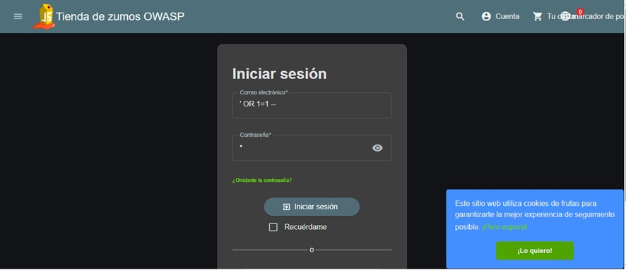
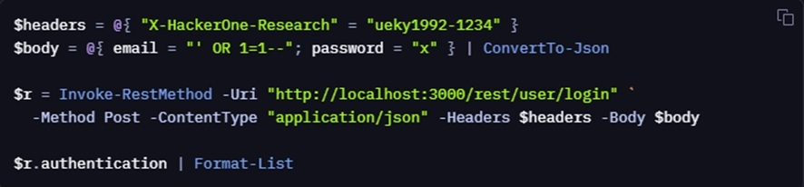
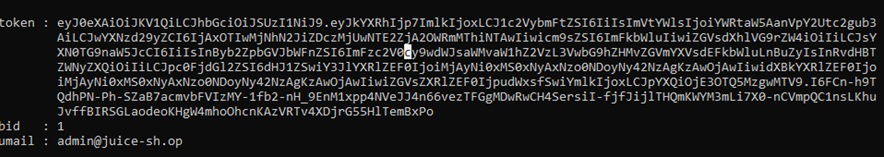
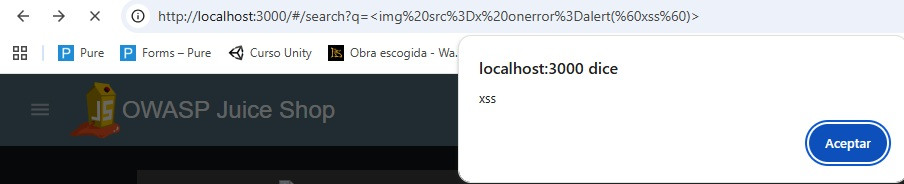
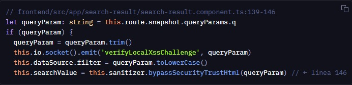
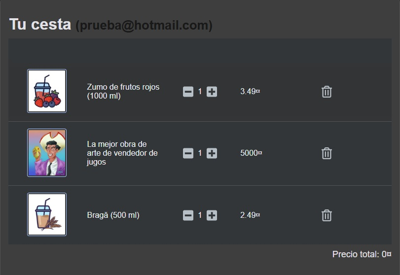
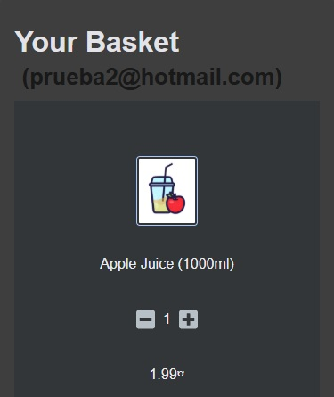
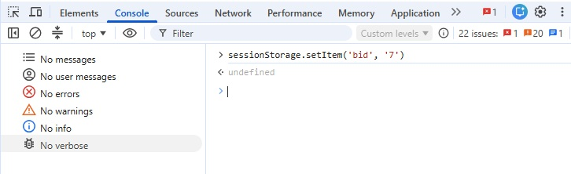
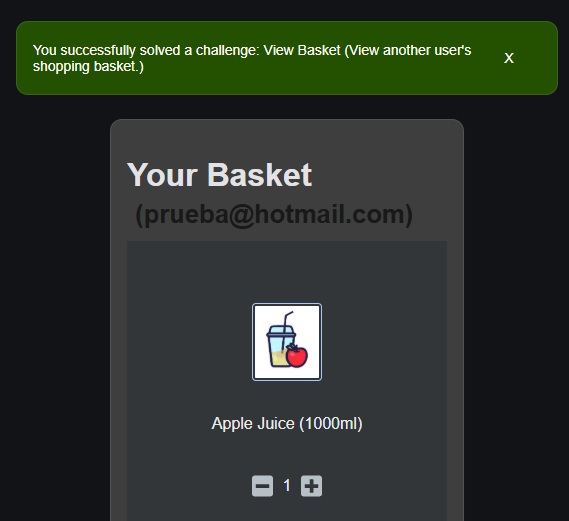

# **Hallazgo 01 – SQL Injection en el inicio de sesión**

## **1. Información general**

-	**Aplicación:**					OWASP Juice Shop
-	**Vulnerabilidad:** 			SQL Injection
-	**Categoría:**					OWASP Top 10 – A05:2025 Injection
-	**Severidad preliminar:**		Alta
-	**Componente afectado:**		Función de inicio de sesión
-	**Archivo:**					routes/login.ts
-	**Línea identificada:**			34

## **2. Descripción**

Durante el análisis de seguridad de OWASP Juice Shop se identificó una consulta SQL que incorpora directamente el valor proporcionado por el usuario en el campo de correo electrónico.
Esta construcción puede permitir que una entrada manipulada altere la estructura de la consulta SQL original.

## **3. Evidencia técnica**

La consulta identificada contiene la siguiente expresión:
req.body.email || ''

El valor se concatena directamente dentro de la consulta SQL, sin utilizar parámetros para separar los datos de las instrucciones SQL.

## **4. Prueba de validación**

**Entorno:** Laboratorio local OWASP Juice Shop.

**Procedimiento realizado:**

Se prueba tanto en modo grafico enviar la Injection SQL como atreves de PowerShell con el código obtenido de opencode.

**Resultado obtenido:**

En modo grafico juice-shop mostro con una felicitación que se encontro una vulnerabilidad.
En modo PowerShell se devolvió por la consulta un bid y un mail mostrando que se pudo autenticar

## **5. Evidencias**








## **6. Impacto potencial**

Un atacante podría manipular consultas SQL para acceder a información no autorizada o alterar el comportamiento de las operaciones de base de datos, dependiendo de los permisos y controles existentes.

## **7. Recomendación**

Utilizar consultas SQL parametrizadas mediante Sequelize, evitando concatenar directamente datos proporcionados por el usuario.

También se recomienda aplicar validación de entradas y limitar los privilegios de la cuenta de base de datos.

## **8. Estado de validación**

 -Vulnerabilidad identificada mediante análisis estático.
 
 -Prueba manual realizada.
 
 - Evidencia adjunta.

 ---

# Hallazgo 02 – DOM-Based Cross-Site Scripting (DOM XSS)

## 1. Información general

- **Aplicación:** OWASP Juice Shop
- **Vulnerabilidad:** DOM-Based Cross-Site Scripting
- **Categoría:** Cross-Site Scripting (XSS)
- **Archivo principal:** `search-result.component.ts`
- **Línea vulnerable:** 146
- **Componente:** `SearchResultComponent`
- **Severidad:** Media (preliminar)
- **Estado:** Prueba manual reportada como exitosa.

## 2. Descripción

Se identificó una vulnerabilidad DOM-Based XSS en la funcionalidad de búsqueda de OWASP Juice Shop.

El parámetro `q` de la URL es leído por el código JavaScript del cliente y posteriormente incorporado al DOM mediante `innerHTML`.

El uso de `bypassSecurityTrustHtml()` hace que Angular considere confiable el contenido recibido, evitando su sanitización habitual.

## 3. Evidencia técnica

**Source:**
`this.route.snapshot.queryParams.q`

**Sink:**
`[innerHTML]` en `search-result.component.html`.

**Código vulnerable:**

```javascript
this.searchValue = this.sanitizer.bypassSecurityTrustHtml(queryParam)
```

Se comprobó la ejecución de JavaScript mediante el siguiente payload:

``

**Captura de pantalla:** 



**Captura – Código vulnerable**




## 4. Prueba realizada

Se utilizó la funcionalidad de búsqueda de Juice Shop en el entorno local.

**Payload utilizado:**

```html

```

**Resultado observado:**

Según la prueba manual realizada, se consiguió ejecutar JavaScript en el navegador mediante el evento `onerror` de una imagen cuyo recurso no pudo cargarse.

## 5. Impacto potencial

La ejecución de JavaScript dentro del origen de la aplicación puede permitir:

- Manipulación del contenido de la página.
- Acceso a información disponible para JavaScript en el contexto de la aplicación.
- Acceso potencial a tokens almacenados en localStorage.
- Ejecución de acciones en nombre del usuario, dependiendo de las protecciones existentes.

## 6. Recomendaciones

- Evitar utilizar `bypassSecurityTrustHtml()` con datos proporcionados por usuarios.
- Preferir interpolación de Angular para mostrar texto.
- Utilizar `textContent` cuando se trabaje con JavaScript directamente.
- Aplicar sanitización mediante listas permitidas si es necesario aceptar HTML.
- Implementar Content Security Policy como defensa adicional.

## 7. Estado de validación

- [x] Análisis estático realizado.
- [x] Código vulnerable identificado.
- [x] Prueba manual realizada.
- [x] Captura de ejecución adjunta.
- [ ] Verificación de corrección realizada.

**Nota:** OWASP Juice Shop es una aplicación intencionalmente vulnerable utilizada con fines educativos.

# Hallazgo 03 – IDOR: Acceso no autorizado al carrito de otro usuario

## 1. Información general

- **Aplicación:** OWASP Juice Shop
- **Vulnerabilidad:** Insecure Direct Object Reference (IDOR)
- **Categoría:** OWASP Top 10 2021 – A01: Broken Access Control
- **CWE:** CWE-639 – Authorization Bypass Through User-Controlled Key
- **Severidad preliminar:** Media (CVSS 3.1: 4.3)
- **Componente afectado:** Recuperación de carritos de compra
- **Endpoint afectado:** `GET /rest/basket/:id`
- **Archivo vulnerable:** `routes/basket.ts`
- **Líneas identificadas:** 18–25 y 32
- **Estado:** Vulnerabilidad confirmada mediante prueba manual

---

## 2. Descripción

Durante el análisis de seguridad de OWASP Juice Shop se identificó una vulnerabilidad de control de acceso que permite a un usuario autenticado acceder al carrito de compra perteneciente a otro usuario mediante la modificación del identificador del carrito (`bid`).

La aplicación utiliza el identificador almacenado en `sessionStorage` para recuperar el carrito correspondiente. Este valor puede ser modificado por el propio usuario desde las herramientas de desarrollador del navegador.

Se comprobó que, al modificar el identificador del carrito de la sesión autenticada, la aplicación recuperó información perteneciente a otro usuario sin verificar correctamente la autorización sobre el recurso solicitado.

La vulnerabilidad corresponde a un IDOR horizontal, ya que permite acceder a recursos de otro usuario con el mismo nivel de privilegios.

---

## 3. Evidencia técnica

### Código vulnerable identificado

Archivo:

`routes/basket.ts`

Se identificó que el endpoint obtiene el identificador directamente desde el parámetro de la ruta:

```javascript
const id = req.params.id
```

Posteriormente, realiza una búsqueda del carrito utilizando ese identificador:

```javascript
BasketModel.findOne({
  where: { id },
  include: [...]
})
```

El resultado se devuelve al cliente mediante:

```javascript
res.json(utils.queryResultToJson(basket))
```

La comparación entre el identificador del usuario autenticado y el carrito solicitado se utiliza para marcar el desafío como resuelto, pero no impide la recuperación del recurso.

### Control de acceso identificado

El endpoint cuenta con autenticación mediante `isAuthorized()`, pero no se identificó un control de autorización a nivel de objeto que verifique que el carrito solicitado pertenece al usuario autenticado.

El middleware `appendUserId()` está aplicado a la ruta `/rest/basket`, pero no a `/rest/basket/:id`.

Esto permite que una sesión autenticada solicite otro identificador de carrito.

---

## 4. Prueba de validación

**Entorno:** OWASP Juice Shop ejecutado en laboratorio local.

**Herramientas utilizadas:**
- Navegador web.
- DevTools.
- Console.
- Application / Session Storage.
- Network.

### Procedimiento realizado

1. Se inició sesión en Juice Shop utilizando la cuenta de prueba A.
2. Se verificó que el identificador del carrito de la cuenta A era `6`.
3. Se comprobó el contenido del carrito de la cuenta A.
4. Se identificó un segundo carrito perteneciente a la cuenta B, cuyo identificador era `7`.
5. Desde la consola del navegador correspondiente a la sesión A, se modificó el identificador almacenado en `sessionStorage`.
6. Se recargó la sección del carrito.
7. La aplicación recuperó y mostró el contenido correspondiente al carrito de la cuenta B dentro de la sesión de la cuenta A.

### Identificador original

```text
bid = 6
```

### Identificador modificado

```text
bid = 7
```

La modificación se realizó desde DevTools utilizando el almacenamiento de sesión del navegador.

---

## 5. Resultado obtenido

Se comprobó que la sesión correspondiente al usuario A pudo visualizar el contenido del carrito perteneciente al usuario B.

El carrito original de la cuenta A contenía productos diferentes a los observados después de modificar el identificador.

Tras la modificación, la aplicación mostró:

- La cuenta autenticada A.
- El producto `Apple Juice (1000ml)`, perteneciente al carrito de la cuenta B.
- El mensaje de Juice Shop indicando que el desafío `View Basket` había sido resuelto.

Esto demuestra que el servidor permitió recuperar información de un recurso asociado a otro usuario sin aplicar una autorización adecuada a nivel de objeto.

### Resultado de la prueba

**Vulnerabilidad confirmada.**

Se comprobó acceso no autorizado de lectura a un carrito perteneciente a otro usuario.

No se comprobó la modificación de carritos, la realización de compras ni el uso de cupones sobre recursos ajenos.

---

## 6. Evidencias

Las siguientes capturas documentan el procedimiento realizado:

### Evidencia 1 – Identificador del carrito de la cuenta A

Archivo:

`evidencias/IDOR/seccionstore_cuenta1.jpg`

Demuestra que la sesión de la cuenta A tenía asociado el identificador de carrito `6`.

### Evidencia 2 – Solicitud del carrito original

Archivo:


Muestra la solicitud de referencia:

```http
GET /rest/basket/6
```

### Evidencia 3 – Carrito original de la cuenta A

Archivo:



Muestra el contenido original del carrito de la cuenta A.

### Evidencia 4 – Carrito de la cuenta B

Archivo:



Permite identificar el producto perteneciente al carrito de la segunda cuenta.

### Evidencia 5 – Modificación del identificador

Archivo:



Muestra la modificación del valor del carrito desde la consola del navegador:

```javascript
sessionStorage.setItem('bid', '7')
```

### Evidencia 6 – Desafío IDOR resuelto

Archivo:



Demuestra que, después de modificar el identificador, la sesión de la cuenta A mostró el producto perteneciente al carrito de la cuenta B y que Juice Shop reconoció la resolución del desafío `View Basket`.

---

## 7. Impacto potencial

La explotación de esta vulnerabilidad puede permitir a usuarios autenticados acceder a información perteneciente a otros usuarios.

El impacto comprobado en el laboratorio es la exposición del contenido de otro carrito de compra.

Dependiendo de la información almacenada en los carritos y de la existencia de vulnerabilidades similares en otras operaciones, el impacto potencial podría incluir:

- Exposición de productos seleccionados por otros usuarios.
- Acceso a información asociada a carritos ajenos.
- Violación de la privacidad de los usuarios.
- Posibles riesgos adicionales sobre integridad si otros endpoints presentan controles de autorización deficientes.

No se comprobó la modificación de recursos ni la ejecución de compras sobre carritos ajenos.

---

## 8. Clasificación y severidad

### OWASP Top 10

**A01:2021 – Broken Access Control**

### CWE

**CWE-639 – Authorization Bypass Through User-Controlled Key**

### Severidad estimada

**Media – CVSS 3.1: 4.3**

Vector orientativo:

`CVSS:3.1/AV:N/AC:L/PR:L/UI:N/S:U/C:L/I:N/A:N`

Justificación:

- **AV:N:** el endpoint es accesible a través de la aplicación web.
- **AC:L:** no se requieren condiciones complejas para modificar el identificador.
- **PR:L:** es necesario disponer de una sesión autenticada.
- **UI:N:** no requiere interacción de otra víctima.
- **S:U:** el impacto se mantiene dentro del contexto de la aplicación.
- **C:L:** se comprobó acceso a información de otro carrito.
- **I:N:** no se comprobó modificación de datos.
- **A:N:** no se comprobó impacto sobre la disponibilidad.

La severidad se considera media debido a que se confirmó una exposición de información entre usuarios autenticados, sin evidencia de modificación de recursos o impacto sobre la disponibilidad.

---

## 9. Recomendaciones

- Implementar controles de autorización a nivel de objeto en cada endpoint que acceda a carritos.
- Verificar que el carrito solicitado pertenezca al usuario autenticado antes de devolver información.
- No confiar en identificadores almacenados en `sessionStorage` como mecanismo de autorización.
- Obtener el carrito asociado al usuario autenticado desde el servidor cuando sea posible.
- Aplicar controles de autorización consistentes en todas las rutas relacionadas con carritos.
- Revisar los endpoints de checkout y aplicación de cupones para detectar posibles problemas similares.
- Implementar pruebas de regresión que verifiquen que un usuario no pueda acceder a carritos de otros usuarios.

### Ejemplo de control esperado

Cuando el usuario A solicite el carrito perteneciente al usuario B, el servidor debe validar la propiedad del recurso y rechazar el acceso.

La aplicación debería devolver una respuesta de acceso denegado, por ejemplo:

```http
403 Forbidden
```

o una respuesta equivalente que no revele información del recurso.

---

## 10. Estado de validación

- [x] Análisis estático realizado.
- [x] Endpoint identificado.
- [x] Código relacionado con el acceso al carrito analizado.
- [x] Prueba manual realizada.
- [x] Identificador del carrito modificado.
- [x] Acceso al carrito de otro usuario comprobado.
- [x] Evidencias visuales disponibles.
- [ ] Request y response HTTP completas del acceso no autorizado.
- [ ] Verificación de corrección realizada.

---

## 11. Conclusión

Se identificó y comprobó una vulnerabilidad IDOR en OWASP Juice Shop que permite a un usuario autenticado acceder al carrito de compra de otro usuario mediante la modificación del identificador del recurso.

El problema se relaciona con la ausencia de una validación adecuada de autorización a nivel de objeto en el endpoint de recuperación de carritos.

La prueba permitió demostrar la exposición de información perteneciente a otro usuario, confirmando un fallo de control de acceso horizontal.

Se recomienda implementar validaciones de propiedad de recursos en el servidor y revisar los endpoints relacionados para evitar vulnerabilidades similares.

---

**Entorno:** Laboratorio local autorizado – OWASP Juice Shop.

**Proyecto:** Portfolio de Ciberseguridad – Web Application Pentesting.


